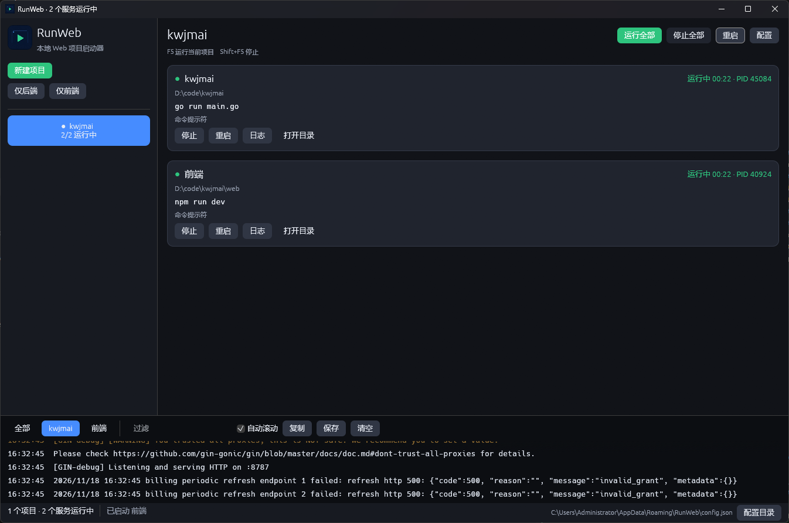
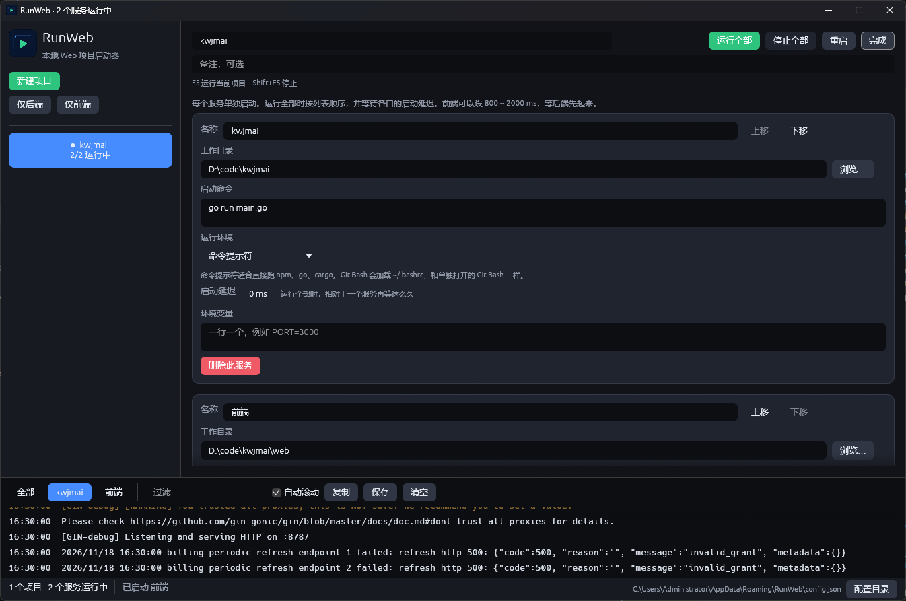

# RunWeb

Windows 上的本地 Web 项目启动器。一个项目里的后端、前端和其他进程放在一起，点一次全部拉起，日志留在同一个窗口里。



## 功能

- 同时管理多个项目，每个项目可以有多个服务
- 运行全部、停止全部、重启，也可以单独启动某一个服务
- 实时日志：按服务查看、过滤、自动滚动、复制、保存
- 启动延迟。运行全部时按列表顺序等待，方便前端等后端先起来
- 运行环境可选命令提示符或 Git Bash。Git Bash 会加载 `~/.bashrc`
- 每个服务单独的工作目录和环境变量
- 停止服务时结束整棵进程树，npm、node 这类子进程会一起退出
- 配置保存在本机，下次打开还在

## 配置服务

点右上角「配置」，为每个服务填写工作目录和启动命令。



常用命令可以直接写：

```text
go run main.go
npm run dev
cargo run
```

多行命令按顺序执行。环境变量一行一个，例如 `PORT=3000`。

前端若需要等后端，把启动延迟设成 800～2000 毫秒。运行全部时，这个时间是相对上一个服务的等待。

## 构建

需要 Rust 稳定版。

```powershell
cargo run
```

发布版不带控制台窗口：

```powershell
cargo build --release
```

生成的程序在 `target/release/runweb.exe`。

## 配置文件

默认位置：

```text
%APPDATA%\RunWeb\config.json
```

可执行文件旁边如果已经有 `config.json`，优先使用旁边这份，方便整份目录拷走。相对工作目录相对这份配置文件所在的目录解析。

状态栏右侧可以打开配置所在目录。

## 快捷键

| 按键 | 作用 |
| --- | --- |
| F5 | 运行当前项目 |
| Shift+F5 | 停止当前项目 |

## 运行环境

命令在 ConPTY 里执行，输出按行流到日志。中文按系统编码解码。

服务使用当前 Windows 用户的环境，不继承启动 RunWeb 的那个程序额外带进来的变量。这样本机已经缓存的 Go 工具链、npm 和 PATH 与平时打开的终端一致。

需要 bash 语法（`export`、`source` 等）时，把该服务的运行环境改成 Git Bash。
